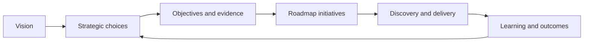
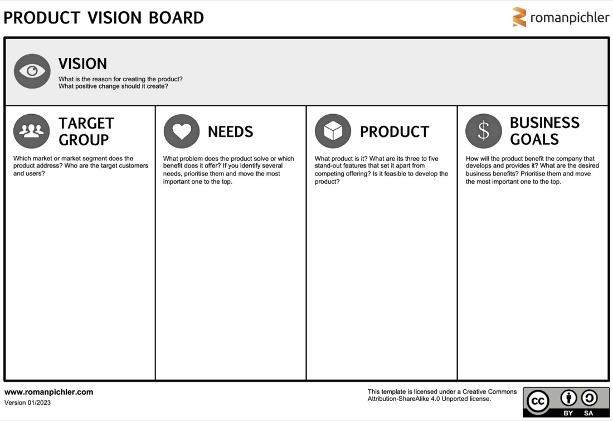
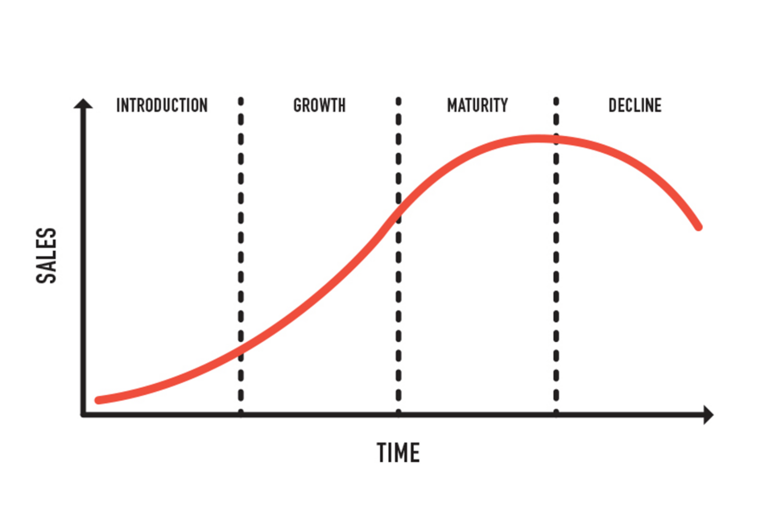

# Vision and Product Strategy

## A Chain of Decisions

A roadmap should not begin with a list of requested features. It should make a
product strategy visible by connecting a desired future to choices about where
to focus.

| Artifact | Central question | Typical horizon |
|---|---|---|
| Vision | What meaningful future are we trying to create? | Long-term and durable |
| Strategy | Where will we play, what will we prioritize, and what will we not do? | Adaptable direction |
| Objectives | Which measurable outcomes show progress? | Reviewable outcome period |
| Roadmap | Which problem areas or initiatives should move us toward those outcomes? | Directional sequence |
| Release plan | What approved scope is expected for a specific release? | Delivery planning |
| Backlog | What work may be explored or delivered next? | Operational execution |

The arrows run back as well as forward. Evidence from delivery and user
outcomes may require the strategy or roadmap to change.

## Product Vision

A useful vision describes a future state, a group that benefits, and the change
that matters. It should be memorable enough to guide decisions but broad enough
to allow different solutions.

Test a vision with these questions:

- Is the beneficiary or target group clear?
- Is the important need or change visible?
- Does it describe an outcome rather than a product specification?
- Is it ambitious without making unsupported claims?
- Can the team use it to reject work that does not contribute?

*Roman Pichler's Product Vision Board connects the vision to target groups,
needs, the product, and business goals. It is a thinking aid rather than a form
that guarantees a sound strategy.*

Source: [Roman Pichler, The Product Vision Board](https://www.romanpichler.com/tools/product-vision-board/), copyright Roman Pichler.

## Product Strategy Requires Choices

A strategy translates the vision into a coherent approach. It states:

- the users, market, or internal groups in focus;
- the needs and outcomes that matter most;
- the advantage, capability, or approach the organization will use;
- the constraints and risks it will respect;
- the measures that indicate progress; and
- what is deliberately outside the current focus.

A collection of goals is not yet a strategy. Strategy includes trade-offs and
coherent actions. If every user, problem, and opportunity is equally important,
the roadmap cannot express a meaningful direction.

## Strategy Changes with Context

The maturity of a product changes the questions a roadmap must answer. A new
product may emphasize validation and learning; a mature product may balance
retention, reliability, efficiency, technical health, and new growth.

*A simple product-life-cycle model reminds teams that strategic priorities can
change as a product moves from introduction through growth and maturity.*

Source: [Tres West, Product Life Cycle Management, Wikimedia Commons](https://commons.wikimedia.org/wiki/File:Product_Life_Cycle_Management.png), licensed under [CC BY-SA 4.0](https://creativecommons.org/licenses/by-sa/4.0/).

Do not infer a lifecycle stage from age alone. Use actual evidence such as user
adoption, retention, operational burden, market change, and strategic intent.

## Check Your Understanding

1. Why is a list of desired features not a product strategy?
2. What makes a vision useful for roadmap decisions?
3. Why should a strategy include explicit exclusions?

Show solution

1. Features are possible solutions. They do not explain the intended outcome,
   target group, advantage, evidence, or trade-offs.
2. It names a meaningful future and beneficiary clearly enough to guide choices
   while leaving room to discover solutions.
3. Exclusions reveal focus, prevent every request from appearing strategic, and
   make resource trade-offs visible.

## References

- [Roman Pichler: The Product Vision Board](https://www.romanpichler.com/tools/product-vision-board/)
- [Roman Pichler: What Exactly Is a Product Strategy?](https://www.romanpichler.com/blog/what-is-a-product-strategy/)
- [Wikimedia Commons: Product Life Cycle Management](https://commons.wikimedia.org/wiki/File:Product_Life_Cycle_Management.png)
