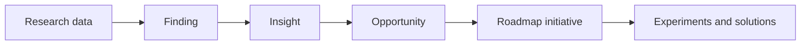
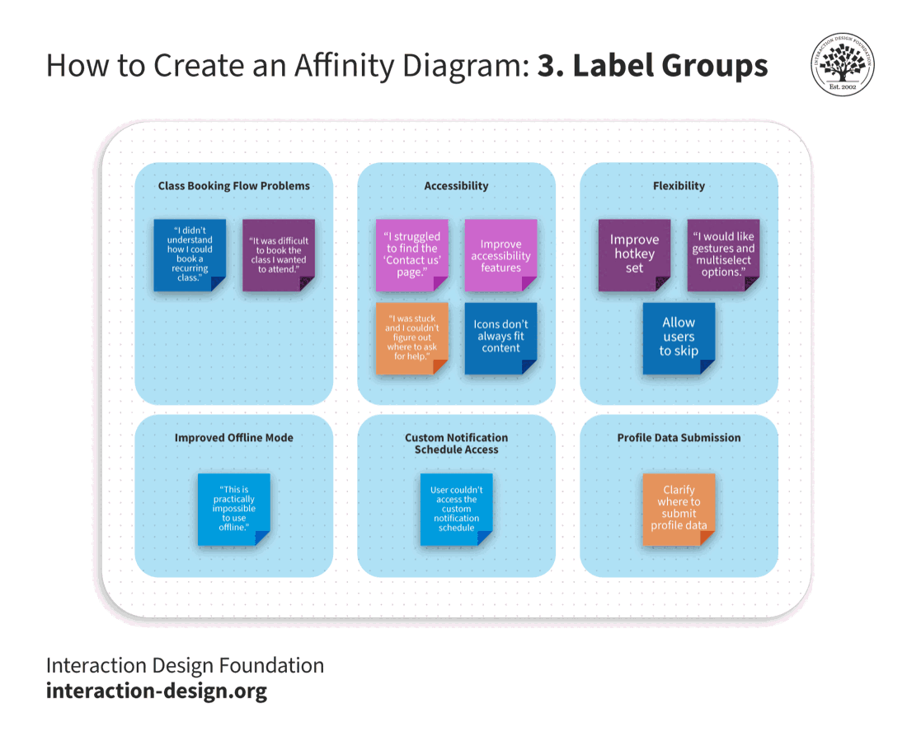

# From Evidence to Opportunities

## Preserve the Evidence Chain

Roadmap initiatives should be grounded in observed needs, business evidence,
technical knowledge, or mandatory constraints. They should not appear because a
feature request sounds plausible.

Use a traceable chain:

- **Data:** what a participant said or did, an analytics event, a support case,
  operational data, or another source record.
- **Finding:** a pattern or notable observation in the data.
- **Insight:** an interpretation explaining why the finding matters.
- **Opportunity:** a user or business problem worth addressing.
- **Initiative:** a strategic direction intended to improve an outcome.
- **Experiment or solution:** one possible way to test or address the problem.

Keep the transitions visible. An insight is an interpretation, not raw fact;
an initiative is a choice, not the inevitable result of research.

## Synthesize Qualitative Research

1. Collect source notes and label their origin.
2. Return to the research question and sampling limitations.
3. Write one observation or quote per note without changing its meaning.
4. Group related notes without naming the groups too early.
5. Name themes only after patterns emerge.
6. Search for contradictions, minority experiences, and missing perspectives.
7. Write findings and insights with links back to source notes.
8. Identify opportunities without prescribing a feature.

*Affinity diagramming groups individual observations into patterns and higher
level themes. The grouping is collaborative interpretation, so source notes and
contradictory evidence must remain accessible.*

Source: [Interaction Design Foundation, Affinity Diagrams](https://www.interaction-design.org/literature/topics/affinity-diagram), licensed under [CC BY-SA 4.0](https://creativecommons.org/licenses/by-sa/4.0/).

## Write Evidence-Backed Opportunities

A useful opportunity statement contains:

> **[User or stakeholder]** struggles to **[make progress]** in **[context]**,
> which contributes to **[observable consequence]**. We believe improving this
> could influence **[outcome]**. Evidence: **[sources]**. Unknowns: **[gaps]**.

Avoid statements such as "users need a chatbot." That sentence embeds a
solution and often hides the original problem. "Support colleagues cannot find
the current policy while handling a case" preserves more solution space.

## Assess Evidence Strength

For each opportunity, record:

- source type, sample, and collection date;
- whether it is observed, reported, inferred, or assumed;
- frequency and severity without confusing the two;
- contradictory or missing evidence;
- relevance to the target group and current context; and
- the next evidence that would change the decision.

AI summaries do not create new evidence. If Claude clusters twelve supplied
interview notes, the source remains those twelve notes and the cluster remains
an interpretation for human review.

## Check Your Understanding

1. What is lost when raw research is converted directly into features?
2. Why should contradictory observations remain visible?
3. Can Claude-generated user quotes be used as research evidence?

Show solution

1. The team loses the chain from evidence to finding, insight, opportunity, and
   intended outcome, making alternative solutions harder to consider.
2. They may reveal different segments, contexts, risks, or weak themes and stop
   the roadmap from presenting false consensus.
3. No. They are synthetic examples, not observations from real users.

## References

- [Interaction Design Foundation: Affinity Diagrams](https://www.interaction-design.org/literature/topics/affinity-diagram)
- [GOV.UK Service Manual: Analyse a Research Session](https://www.gov.uk/service-manual/user-research/analyse-a-research-session)
- [GOV.UK Service Manual: Sharing User Research Findings](https://www.gov.uk/service-manual/user-research/sharing-user-research-findings)
