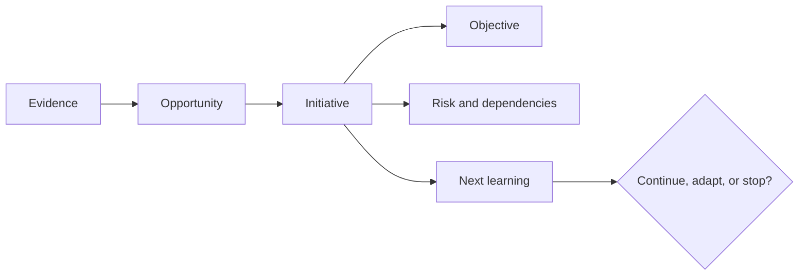
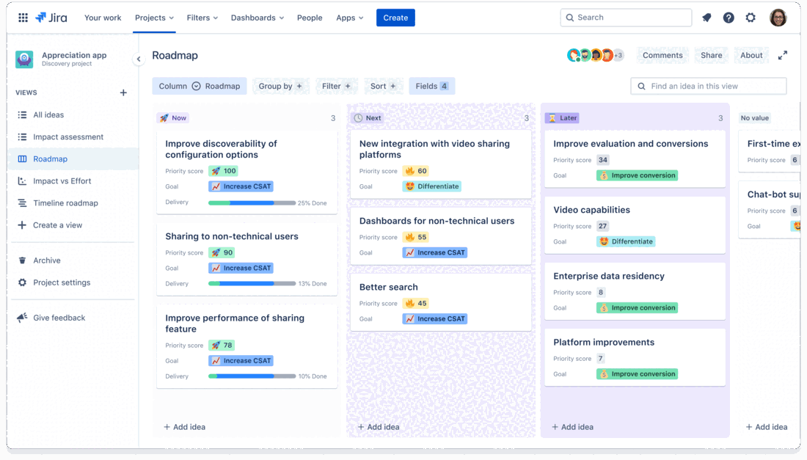

# Roadmaps as Strategic Communication

## What a Roadmap Does

A product roadmap is a current, high-level explanation of how selected
initiatives may advance a strategy. It helps people understand:

- the outcomes being pursued;
- the problem areas receiving attention;
- why those areas matter now;
- the relationship between initiatives;
- the confidence and uncertainty around future work; and
- what is deliberately not being pursued.

GOV.UK guidance emphasizes that a roadmap should be easy to understand and easy
to adjust when priorities change. A roadmap is therefore both a decision record
and a communication tool, not a permanent contract.

## A Roadmap Is Not Every Planning Artifact

| Artifact | Appropriate detail | Main purpose |
|---|---|---|
| Product roadmap | Outcomes, themes, initiatives, horizons | Communicate strategy and direction |
| Release plan | Approved release scope, dependencies, target | Coordinate a bounded release |
| Delivery plan | Tasks, milestones, owners, sequencing | Coordinate execution |
| Backlog | Candidate and actionable work items | Manage discovery and delivery work |
| Gantt chart | Activities, dependencies, calendar dates | Plan predictable or constrained work |

A roadmap may link to these artifacts, but combining all of them creates a
document that is too detailed for strategic communication and too vague for
delivery management.

## Define Roadmap Initiatives

An initiative is a significant problem area or strategic direction that may
contain research, experiments, operational changes, and product changes. It is
larger than a user story but more actionable than a vision.

A strong initiative states:

- the opportunity or problem;
- the people affected;
- the objective and expected outcome;
- supporting evidence and confidence;
- important risks, constraints, and dependencies;
- what must be learned next;
- possible approaches without prematurely selecting one; and
- an outcome review signal.

Compare these two cards:

| Feature commitment | Outcome-oriented initiative |
|---|---|
| Build an AI support chatbot by Q3 | Reduce avoidable effort when customers seek routine support, while maintaining answer quality and safe escalation |

The second card leaves room to test search, content improvements, workflow
changes, guided forms, or an assistant. It also creates a basis for deciding
whether the initiative worked.

## Trace Each Initiative

An initiative without evidence is a hypothesis. An initiative without an
objective cannot demonstrate value. An initiative without a learning plan may
remain on the roadmap long after its assumptions fail.

## Roadmap Audiences

Different audiences need different views of the same underlying decisions:

- leadership needs strategic contribution, investment, risk, and confidence;
- product and delivery teams need problem context, dependencies, and learning;
- customer-facing teams need language they can use without promising features;
- governance groups need mandatory constraints, ownership, and review points;
- customers may need outcomes and direction without confidential detail.

Create views from one source of truth. Do not create separate roadmaps with
contradictory commitments.

*This Jira Product Discovery example combines horizon placement, objectives,
owners, and scoring in one view. The visual tool can support communication, but
it cannot supply the strategy or evidence behind the cards. Source:
[Atlassian, Agile Roadmaps](https://www.atlassian.com/agile/product-management/roadmaps).*

## Check Your Understanding

1. Why is a roadmap not a delivery plan?
2. What makes an initiative different from a feature?
3. Why should one roadmap support several audience views?

Show solution

1. It communicates strategic direction and uncertainty at a higher level; a
   delivery plan coordinates specific execution.
2. An initiative frames a problem and outcome and may contain several possible
   solutions, experiments, or operational changes.
3. Different audiences need different detail, but contradictory source
   roadmaps create confusion and accidental promises.

## References

- [GOV.UK Service Manual: Developing a Roadmap](https://www.gov.uk/service-manual/agile-delivery/developing-a-roadmap)
- [ProdPad: Product Roadmap](https://www.prodpad.com/glossary/product-roadmap/)
- [Atlassian: Agile Roadmaps](https://www.atlassian.com/agile/product-management/roadmaps)
