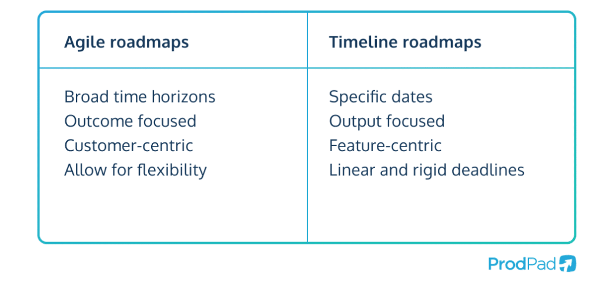
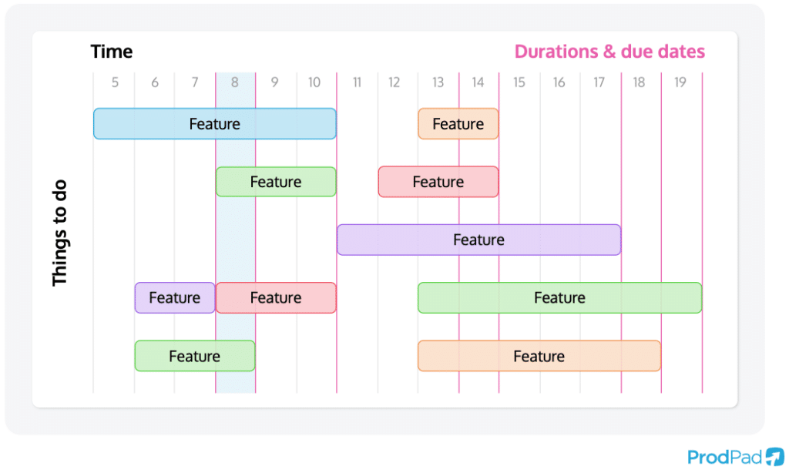

# Roadmap Formats and Confidence

## Select a Format for the Decision

No roadmap format is universally correct. Select one according to the audience,
purpose, real constraints, and amount of uncertainty.

| Format | Organizes work by | Useful when | Main risk |
|---|---|---|---|
| Now-Next-Later | Confidence and priority horizons | Direction must adapt as evidence changes | Buckets become disguised dates |
| Outcome or goal based | Objectives and measurable outcomes | Teams need autonomy over solutions | Outcomes remain too vague |
| Theme based | Strategic problem areas | Several teams contribute to shared priorities | Themes become permanent labels |
| Timeline | Dates and sequence | Deadlines or dependencies are genuinely fixed | Uncertain work appears committed |
| Release roadmap | Planned release boundaries | Scope and release coordination are central | Strategy collapses into feature shipping |

*Agile roadmaps emphasize direction and adaptability, while timeline roadmaps
emphasize sequence and dates. The appropriate choice depends on genuine
certainty and decision needs rather than visual preference.*

Source: [ProdPad, The Ultimate Guide to Product Roadmaps](https://www.prodpad.com/guides/product-roadmaps/), copyright ProdPad.

## Now-Next-Later as Confidence Horizons

Now-Next-Later is most useful when the columns communicate decreasing confidence
rather than three disguised calendar periods.

- **Now:** active initiatives with a sufficiently understood problem, approved
  investment, and clear next learning or outcome signal.
- **Next:** important opportunities with credible evidence but unresolved
  assumptions, feasibility, dependencies, or approach.
- **Later:** strategic options worth monitoring with lower confidence and less
  detail.

Items do not automatically move from right to left. New evidence may advance,
reframe, pause, merge, or remove them.

*A timeline can communicate sequencing clearly, but dates and detailed feature
bars may be interpreted as commitments. Use this format when the underlying
work supports that precision.*

Source: [ProdPad, The Ultimate Guide to Product Roadmaps](https://www.prodpad.com/guides/product-roadmaps/), copyright ProdPad.

## Define Entry and Exit Conditions

Give every horizon explicit conditions. For example:

| Horizon | Entry condition | Evidence expected | Exit condition |
|---|---|---|---|
| Now | Objective, owner, evidence, capacity, and critical risks reviewed | Strongest available evidence and active learning plan | Outcome reviewed; continue, adapt, or stop |
| Next | Strategic fit and credible opportunity established | Research, feasibility, dependency, and risk questions | Ready for investment, deferred, or rejected |
| Later | Relevant strategic hypothesis recorded | Early signal and named unknowns | Review trigger reached or relevance lost |

This prevents "Later" from becoming an unreviewed storage area and "Now" from
containing more work than the organization can actively support.

## When Dates Belong

Dates are appropriate when they reflect real constraints, such as regulation,
contractual obligations, a coordinated launch, an expiring opportunity, or a
well-understood delivery commitment. Record:

- whether the date is fixed, targeted, forecast, or illustrative;
- who owns it and what evidence supports it;
- dependencies and confidence;
- consequences of missing it; and
- the scope or quality trade-offs that are and are not acceptable.

Do not remove dates merely to look agile. Do not add them merely to make an
uncertain future feel controlled.

## Check Your Understanding

1. Why are Now, Next, and Later better treated as confidence horizons?
2. When is a timeline roadmap appropriate?
3. What prevents a Later column from becoming a backlog archive?

Show solution

1. Future initiatives usually have less evidence and more unresolved decisions;
   confidence communicates that uncertainty without invented precision.
2. When dates and sequencing are genuinely decision-relevant and supported by
   constraints, dependencies, or strong delivery evidence.
3. Explicit entry, evidence, review, and removal conditions plus a regular
   review trigger.

## References

- [ProdPad: Now-Next-Later Roadmap](https://www.prodpad.com/glossary/now-next-later-roadmap/)
- [ProdPad: The Ultimate Guide to Product Roadmaps](https://www.prodpad.com/guides/product-roadmaps/)
- [GOV.UK Service Manual: Developing a Roadmap](https://www.gov.uk/service-manual/agile-delivery/developing-a-roadmap)
