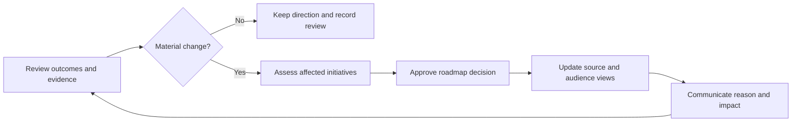

# Roadmap Governance and Communication

## A Roadmap Is a Living Decision Record

Updating a roadmap is not a failure to plan. It is evidence that the team is
responding to new information. Trust depends on making the reasons for change
visible.

For each change, record:

- what moved, changed, entered, or left;
- the new evidence, constraint, or decision;
- who approved the change;
- affected objectives, dependencies, and audiences;
- any commitment that must be renegotiated; and
- the next review trigger.

*A Government Digital Service roadmapping workshop. Building and revising the
roadmap collaboratively makes assumptions, groupings, and disagreements easier
to examine before they become commitments. Source: [Government Digital Service,
How we are using roadmaps in government](https://gds.blog.gov.uk/2017/03/27/how-we-are-using-roadmaps-in-government/),
licensed under the [Open Government Licence v3.0](https://www.nationalarchives.gov.uk/doc/open-government-licence/version/3/).*

## Review the Right Signals

A roadmap review should examine more than delivery status:

- progress toward the objective;
- current user and business evidence;
- experiment results and failed assumptions;
- technical feasibility and operational health;
- legal, safety, privacy, security, or accessibility gates;
- dependency and capacity changes;
- opportunity cost and work that should stop; and
- whether each initiative still fits the strategy.

Shipping a planned feature does not prove that the initiative succeeded.
Likewise, learning that an approach should stop can be valuable progress.

## Communicate Degrees of Commitment

Use precise language:

| Status | Appropriate language |
|---|---|
| Exploring | We are investigating this problem and its evidence. |
| Intending | This is a priority direction, subject to unresolved conditions. |
| Committed | Resources and decision authority are approved for a bounded scope. |
| Forecast | Current evidence suggests this result or date, with stated confidence. |
| Fixed obligation | A binding constraint exists, with consequences and ownership. |

Avoid "coming soon" for work that is still an option. Customer-facing or sales
views must not silently strengthen internal language.

## Handle Stakeholder Requests

When a stakeholder asks to add a feature:

1. Clarify the underlying problem, affected group, and desired outcome.
2. Record supporting evidence and urgency.
3. Check strategic fit and mandatory constraints.
4. Compare the request with current initiatives and opportunity cost.
5. Decide whether to reject, investigate, merge, defer, or advance it.
6. Record and communicate the decision.

The roadmap should help negotiate trade-offs, not serve as a queue where every
request eventually becomes a promise.

## Roadmap Quality Test

A strong roadmap allows a reader to answer:

- What outcomes are we pursuing and why?
- Which problem areas are receiving attention?
- What evidence supports them?
- How confident are we, and what remains unknown?
- What is active, being prepared, or only monitored?
- What are we not doing?
- What could change the roadmap?
- Who decides and when is it reviewed?

## Check Your Understanding

1. Why is changing a roadmap not automatically a planning failure?
2. What is the difference between a forecast and a commitment?
3. How should a feature request enter the roadmap decision process?

Show solution

1. A roadmap reflects current evidence; adapting transparently to new evidence
   is part of responsible planning.
2. A forecast is a current prediction with confidence and assumptions. A
   commitment includes approved accountability and a bounded obligation.
3. Translate it into a problem and desired outcome, examine evidence and fit,
   compare opportunity cost, then record an explicit decision.

## References

- [GOV.UK Service Manual: Developing a Roadmap](https://www.gov.uk/service-manual/agile-delivery/developing-a-roadmap)
- [Atlassian: Agile Roadmaps](https://www.atlassian.com/agile/product-management/roadmaps)
- [ProdPad: Initiatives](https://help.prodpad.com/article/531-initiatives)
