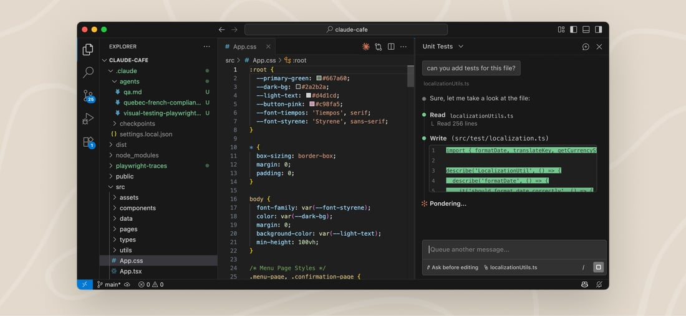
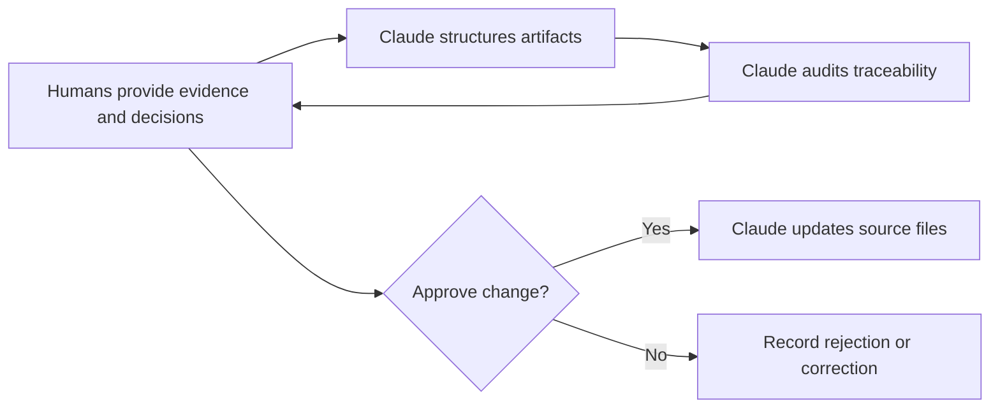

# Claude Code as Roadmap Partner

## Delegate the Repository Work

Claude Code can turn approved inputs into consistent files, trace relationships,
compare scenarios, prepare audience views, and identify contradictions. The
group remains responsible for research interpretation, strategic choices,
priority, feasibility, commitments, and final communication.

Use Claude for:

1. **Structure:** create and update files from the supplied templates.
2. **Traceability:** link evidence, opportunities, objectives, and initiatives.
3. **Challenge:** identify weak evidence, feature-first wording, and hidden
   commitments.
4. **Scenario analysis:** show which initiatives are affected by new evidence or
   constraints.
5. **Maintenance:** apply approved changes consistently across artifacts.

*Claude Code can work through the VS Code extension, CLI, desktop application,
or another supported interface. The important requirement for this project is
access to the relevant files and a visible review step, not a particular
interface. Source: [Anthropic, Use Claude Code in VS Code](https://code.claude.com/docs/en/ide-integrations).*

## Establish the Evidence Boundary

Require Claude to label material inputs as:

- observed evidence;
- interpreted finding or insight;
- team assumption;
- externally sourced information;
- constraint or obligation;
- estimate or forecast;
- stakeholder request;
- unresolved question; or
- AI suggestion.

Claude must not promote a stakeholder request into evidence, an assumption into
a finding, or an option into a commitment.

## Starting Prompt

> Read the lessons and templates in this repository. Interview us about our
> chosen product, evidence, strategy, prior prioritization, constraints, and
> audience. Do not invent research, targets, feasibility, dates, estimates, or
> stakeholder agreement. First create a list of missing information and propose
> an artifact plan. Wait for approval before creating files. Label assumptions,
> unknowns, and AI suggestions explicitly, and show material changes before
> applying them.

## Approval Gates

Claude must wait for the group before it:

- rewrites a finding or opportunity in a way that changes meaning;
- selects or changes objectives, initiatives, horizons, or exclusions;
- assigns confidence or evidence strength;
- introduces a date or commitment;
- resolves a conflict between stakeholders;
- removes a risk, dependency, or unknown; or
- publishes the final roadmap narrative.

## Ask Claude to Audit, Not Decorate

Before finalizing, ask Claude to report findings without editing:

- Which initiative is a feature disguised as a problem?
- Which evidence cannot be traced to a supplied source?
- Which initiative does not support an objective?
- Which horizon implies more confidence than the evidence supports?
- Which dependency or mandatory gate changes the sequence?
- Which item lacks a learning or outcome signal?
- Which stakeholder view strengthens the commitment language?
- Which current initiative should stop if its assumption fails?
- What is absent because it was deliberately excluded, and what was forgotten?

The group accepts, corrects, or rejects each material finding and records why.

## Check Your Understanding

1. Which roadmap work can Claude perform safely?
2. Why should Claude not infer initiative priority from polished descriptions?
3. What does an approval gate protect?

Show solution

1. It can structure supplied information, maintain links, apply approved
   changes, compare scenarios, and audit consistency.
2. Writing quality is not evidence of user value, strategic fit, feasibility,
   or stakeholder commitment.
3. It keeps material interpretations and decisions visible and human-owned
   before they become part of the roadmap.

## References

- [Claude Code Docs: Common Workflows](https://code.claude.com/docs/en/common-workflows)
- [Claude Code Docs: Best Practices](https://code.claude.com/docs/en/best-practices)
