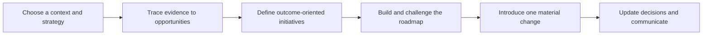
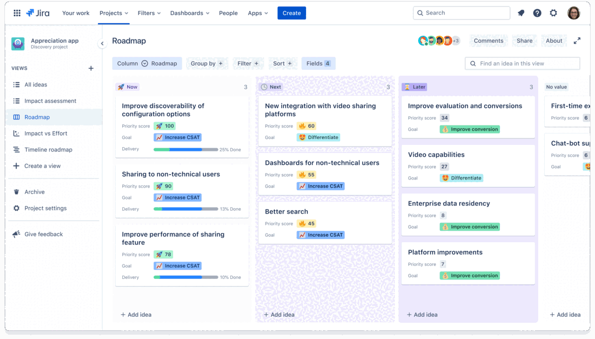

# Project Handout: Build an Evidence-Backed Product Roadmap

## Your Assignment

Choose a real or plausible product, service, internal process, or data/AI
opportunity. Create a roadmap that shows how selected initiatives could advance
a clear strategy while making evidence, uncertainty, dependencies, and
commitment levels visible.

You may continue the challenge used in the estimation and prioritization
project, use another earlier course project, or select a different context. Each
group should make its own choice. Do not use confidential, personal, or
commercially sensitive information.

Claude Code should create and maintain most of the files. The group acts as the
AI Project Manager: it supplies and interprets evidence, approves strategic
choices, decides the roadmap, challenges Claude's output, and communicates the
result.

## The Project in One View

The seven files below capture this one decision process. They are not seven
separate reports, and a polished slide deck is not required.

## What You Must Deliver

Your repository must contain these seven completed artifacts:

| File | Purpose | Done when |
|---|---|---|
| `strategy-brief.md` | Define the direction and constraints | Objectives, choices, exclusions, audience, and decision owner are explicit |
| `evidence-map.md` | Trace evidence to opportunities | Every major opportunity links to a source or labelled assumption |
| `initiative-register.md` | Frame possible strategic work | Each initiative links to an objective, evidence, risk, and learning signal |
| `roadmap.md` | Communicate direction and confidence | The format, horizon rules, initiatives, exclusions, and commitments are clear |
| `roadmap-decision-log.md` | Preserve important decisions | Material inclusions, exclusions, movements, and overrides have reasons and owners |
| `roadmap-review.md` | Show adaptation | One new event leads to an explicit keep, change, advance, pause, or stop decision |
| `ai-collaboration-log.md` | Make human oversight visible | Material Claude input is accepted, corrected, or rejected with reasons |

The final roadmap is not a feature list with decorative columns. Someone who
did not join the exercise should understand what outcomes matter, why each
initiative belongs, what is uncertain, and what could change the direction.

## Minimum Scope

Keep the project small enough to reason about deeply. A complete submission
normally contains:

- one clearly defined product or service context and one roadmap audience;
- two or three strategic objectives;
- at least three shareable evidence sources, or an explicitly labelled case
  evidence pack;
- four to six opportunities and four to six candidate initiatives;
- one primary roadmap view with explicit horizon or timeline rules; and
- one material change that forces the roadmap to be reconsidered.

Depth matters more than volume. Do not build an application, detailed delivery
plan, or large backlog unless you choose an optional extension.

## Ground Rules

- Use evidence you can share and identify its limitations.
- Keep observations, interpretations, opportunities, initiatives, and solutions
  distinct.
- Do not ask Claude to fabricate research, personas, metrics, feasibility, or
  stakeholder agreement.
- Connect every initiative to an objective and at least one evidence source or
  explicit assumption.
- Define horizon or timeline rules before placing initiatives.
- Use dates only when a genuine constraint or supported commitment requires
  them.
- Record what the roadmap excludes and why.
- Show material Claude changes before approving them.

## How to Work with Claude

Use any Claude interface that can access the project files. For each phase:

1. give Claude only the evidence and decisions the group can support;
2. ask it to structure, compare, or audit without making the final choice;
3. inspect the proposed changes and challenge unsupported certainty;
4. approve, correct, or reject the result; and
5. let Claude update the connected files consistently.

If the context is fictional, label scenario evidence as fictional. Plausible
details generated by Claude are still assumptions, not user research.

## Phase 1: Establish the Context

Open the project with Claude Code using any available interface, such as the VS
Code extension, CLI, desktop application, or another graphical interface.

Ask Claude to read the lessons and templates, then interview the group. Provide
the context needed to understand:

- target users or stakeholders;
- the problem or opportunity;
- current evidence and its limitations;
- business or service outcomes;
- relevant strategic constraints;
- decisions from the previous prioritization project, when reused;
- legal, safety, privacy, security, accessibility, or operational gates; and
- the final roadmap audience and decision owner.

Claude must first return missing information and proposed artifacts without
inventing answers. Copy and complete
[the strategy brief](templates/strategy-brief.md) as `strategy-brief.md`.

You can begin with this request:

> Read the lessons and templates, then interview us about our context. Separate
> supplied evidence, assumptions, constraints, and unknowns. Do not invent
> research, agreement, feasibility, dates, or metrics. Propose the files and
> missing information first, and wait for our approval before editing.

**Quality gate:** the strategy contains real choices and exclusions, not only a
vision statement and a collection of desirable goals.

## Phase 2: Build the Evidence Chain

Copy [the evidence map](templates/evidence-map.md) as `evidence-map.md`. Supply
research notes, survey summaries, analytics, support patterns, operational
observations, previous project evidence, or a clearly labelled fictional case.

Ask Claude to organize the supplied material into candidate findings while
preserving source IDs. The group must then:

1. verify that summaries preserve the source meaning;
2. separate observations from interpretation;
3. look for contradictions and missing groups;
4. approve findings and insights; and
5. write several opportunities as problems and outcomes, not features.

**Quality gate:** another group can trace every important opportunity to the
supplied evidence or see that it is only an assumption.

## Phase 3: Define Roadmap Initiatives

Copy [the initiative register](templates/initiative-register.md) as
`initiative-register.md`. Use the prior estimation and prioritization result as
an input when available, but reassess it against the current strategy and
evidence.

For each candidate initiative, approve:

- opportunity or problem area;
- objective and expected outcome;
- supporting evidence and confidence;
- risks, mandatory gates, and dependencies;
- next learning needed; and
- possible approaches kept separate from the initiative itself.

Ask Claude to identify feature-first wording and initiatives that are too broad,
too small, unsupported, or disconnected from an objective.

**Quality gate:** each initiative leaves room for discovery and contains a
signal for deciding whether to continue, adapt, or stop.

## Phase 4: Choose the Roadmap Format

Ask Claude to compare at least three formats from module 04 against the purpose,
audience, uncertainty, and real constraints. The group chooses the format and
records why it fits better than the alternatives.

Now-Next-Later is recommended when the future contains substantial uncertainty.
If selected, define the columns as confidence horizons. A timeline or release
format is acceptable when dates and scope have a genuine basis.

*Example of a Now-Next-Later view in Jira Product Discovery. The interface is
only the presentation layer: the group still needs to justify each initiative,
horizon, and priority. Source: [Atlassian, Agile Roadmaps](https://www.atlassian.com/agile/product-management/roadmaps).*

Copy [the roadmap template](templates/roadmap.md) as `roadmap.md`. Define entry,
evidence, and review conditions before placing initiatives.

**Quality gate:** changing a column label to a quarter would not reveal that the
group has merely hidden unsupported delivery dates.

## Phase 5: Build and Challenge the Roadmap

Place the approved initiatives, then ask Claude to audit the result without
editing it. The audit must identify:

- weak or missing evidence;
- objectives with no initiative and initiatives with no objective;
- hidden feature commitments;
- unsupported confidence or dates;
- ignored dependencies and gates;
- too much concurrent work;
- duplicated initiatives;
- missing exclusions; and
- language that changes an option into a promise.

For every material finding, accept it, correct the analysis, turn it into an
unknown, or reject it with a reason. Record important decisions in
[the decision log](templates/roadmap-decision-log.md) and Claude interventions
in [the AI collaboration log](templates/ai-collaboration-log.md).

**Quality gate:** the final placement can be explained through strategy,
evidence, priority, confidence, dependencies, and capacity rather than personal
preference.

## Phase 6: Introduce Change

Use a facilitator-provided event or create one clearly labelled scenario update
that could materially affect the roadmap, for example:

- research contradicts a central user assumption;
- an expected dataset cannot legally or technically be used;
- capacity is reduced;
- an initiative fails its outcome test;
- a fixed external obligation appears;
- a dependency is delayed; or
- a better opportunity emerges from new evidence.

Ask Claude to identify the affected evidence, objectives, initiatives,
dependencies, and audience messages. The group decides what to continue, adapt,
advance, pause, or stop.

Complete [the roadmap review](templates/roadmap-review.md), update approved
files, and add the decisions to the log.

**Quality gate:** every change is traceable to new information or a deliberate
decision, and previous commitments are not silently rewritten.

## Phase 7: Communicate the Direction

Prepare a concise walkthrough for one named audience. It should explain:

1. the vision, strategy, and objectives;
2. the strongest evidence and most important limitations;
3. the roadmap format and horizon definitions;
4. the selected initiatives and explicit exclusions;
5. confidence, dependencies, gates, and commitment levels;
6. the change introduced and how the roadmap responded; and
7. what will be reviewed next.

Claude may draft the narrative, but the group must remove unsupported certainty
and approve the final language. Present directly from the completed artifacts
or use the roadmap as the visual anchor; no additional slide deck is required.

**Quality gate:** the audience can identify the intended outcomes, important
uncertainties, real commitments, explicit exclusions, and next review trigger.

## Final Checklist

- [ ] The vision, strategy, objectives, roadmap, and delivery work are distinct.
- [ ] Strategic choices include explicit exclusions.
- [ ] Evidence sources and limitations are visible.
- [ ] Findings, insights, opportunities, initiatives, and solutions are not
      mixed together.
- [ ] Every initiative supports an objective and has a learning or outcome
      signal.
- [ ] The roadmap format fits its purpose, audience, and uncertainty.
- [ ] Horizon or timeline rules are explicit.
- [ ] Dependencies, gates, risks, and confidence remain visible.
- [ ] Commitment language is accurate.
- [ ] A material change was reviewed and recorded.
- [ ] Claude did not invent evidence or make final decisions.
- [ ] At least one Claude contribution was corrected or rejected with a reason.
- [ ] All seven required files are complete and consistent.

When every item passes, the required project is complete. Continue below only
if the group wants a more demanding scenario.

## Optional Extensions

Begin optional work only after the required artifacts pass the checklist.

### Create Audience-Specific Views

Create leadership, delivery-team, and customer-facing views from the same
source roadmap. Explain which details were changed or hidden and verify that no
view strengthens the commitment level.

### Add an Opportunity-Solution Tree

Connect one objective to opportunities, candidate solutions, and experiments.
Show how the tree informs an initiative without turning every solution into
roadmap scope.

### Build a Portfolio Roadmap

Add a second product or team. Identify shared objectives, competing capacity,
cross-product dependencies, and conflicts that are invisible in separate
roadmaps.

### Add a Genuine Fixed Date

Introduce a regulatory, contractual, or market constraint. Define the date
type, consequence, confidence, acceptable scope trade-offs, and escalation
path. Decide whether to add a timeline view without replacing the strategic
roadmap.

### Connect the Roadmap to GitHub Issues

Ask Claude to propose issues only for approved discovery or delivery work in
Now. Each issue should link back to the initiative and explain its outcome,
scope, evidence, dependencies, and completion signal. Review before creation.

### Run a Pre-Mortem

Assume the roadmap failed to produce its outcomes. Identify plausible causes,
early warning signals, mitigations, and the roadmap decisions they would affect.

### Add Outcome Measurement

Define baselines, leading and lagging indicators, guardrail metrics, data
owners, and review rules for the active initiatives. Do not fabricate values.

### Audit Ethical and Environmental Impact

For an AI or data roadmap, examine privacy, bias, accessibility, energy and
infrastructure choices, human oversight, failure recovery, and affected groups.
Record whether these are gates, criteria, risks, or new initiatives.

## Reflection

- Which roadmap item had the weakest evidence?
- Where did a proposed solution initially hide the real opportunity?
- Which exclusion was hardest to defend?
- What changed when confidence, rather than time, defined the horizons?
- Which new evidence created the most valuable roadmap change?
- Where did Claude sound more certain than the group had earned?
