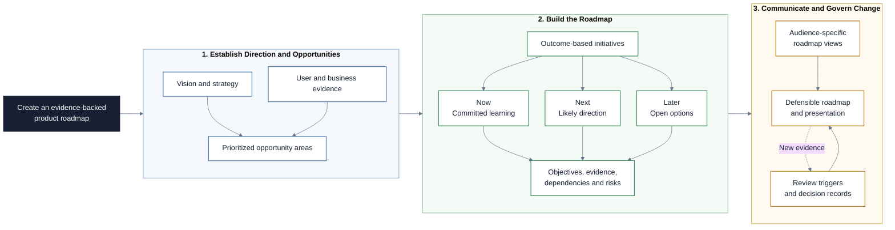

# Product Roadmapping

This Markdown learning path connects product vision, user evidence, strategy,
prioritization, and roadmap communication. Participants build an outcome-based
roadmap that communicates direction and uncertainty without turning early ideas
into feature promises or invented delivery dates.

## Project at a Glance

The project connects vision and evidence to an outcome-based roadmap that
communicates direction, confidence, and change without inventing commitments.

## Learning Objectives

By the end of this repository, you should be able to:

- Distinguish a vision, strategy, roadmap, release plan, and delivery backlog.
- Turn user research findings into evidence-backed opportunities.
- Define initiatives as strategic problem areas with measurable outcomes.
- Select a roadmap format that fits the decision, audience, and uncertainty.
- Build and justify a Now-Next-Later roadmap using confidence horizons.
- Connect initiatives to objectives, evidence, dependencies, risks, and learning.
- Communicate commitments without presenting uncertain work as guaranteed.
- Maintain a roadmap through explicit review triggers and decision records.
- Use Claude Code for structure, critique, and maintenance while retaining human
  ownership of evidence and decisions.

## Learning Path

The modules build on each other in order.

| File / Folder | Description |
|---|---|
| [**01 - Vision and Product Strategy**](01-vision-and-product-strategy.md) | Connect the desired future, strategic choices, objectives, and roadmap. |
| [**02 - From Evidence to Opportunities**](02-from-evidence-to-opportunities.md) | Synthesize research without turning observations directly into features. |
| [**03 - Roadmaps as Strategic Communication**](03-roadmaps-as-strategic-communication.md) | Define roadmap initiatives, audiences, and the boundary between direction and delivery. |
| [**04 - Roadmap Formats and Confidence**](04-roadmap-formats-and-confidence.md) | Compare outcome, theme, Now-Next-Later, timeline, and release roadmaps. |
| [**05 - Roadmap Governance and Communication**](05-roadmap-governance-and-communication.md) | Review, adapt, and communicate a roadmap without hiding uncertainty or change. |
| [**06 - Claude Code as Roadmap Partner**](06-claude-code-as-roadmap-partner.md) | Delegate file creation, consistency checks, scenario analysis, and updates with approval gates. |
| [**07 - Project Handout**](07-project-handout.md) | Create, challenge, and present an evidence-backed roadmap for an original context. |

### Additional Folders and Files

| File / Folder | Description |
|---|---|
| [**assets**](assets/) | Local, attributed illustrations from product-management and research sources. |
| [**templates**](templates/) | Starting structures for evidence, strategy, initiatives, roadmap decisions, and reviews. |

## Getting Started

No Python environment is required for this repository.

1. Create a repository from this template and add collaborators when working
   in a group.
2. Clone the repository and open it locally.
3. Read the lesson files in numerical order.
4. Use Claude Code through any available interface and make the project files
   available to it when the handout introduces the working process.
5. Use the handout and templates to create the project artifacts.

## AI Collaboration Guidelines

Claude may structure supplied research, trace initiatives to objectives,
identify contradictions, and maintain approved files. It must not invent user
evidence, business targets, technical feasibility, stakeholder agreement, or
delivery commitments. Do not enter sensitive data, and record material AI
contributions that the group accepted, corrected, or rejected.

## References & Further Reading

- [GOV.UK Service Manual: Developing a Roadmap](https://www.gov.uk/service-manual/agile-delivery/developing-a-roadmap)
- [Roman Pichler: The Product Vision Board](https://www.romanpichler.com/tools/product-vision-board/)
- [ProdPad: Now-Next-Later Roadmap](https://www.prodpad.com/glossary/now-next-later-roadmap/)
- [Atlassian: Agile Roadmaps](https://www.atlassian.com/agile/product-management/roadmaps)
- [Interaction Design Foundation: Affinity Diagrams](https://www.interaction-design.org/literature/topics/affinity-diagram)
