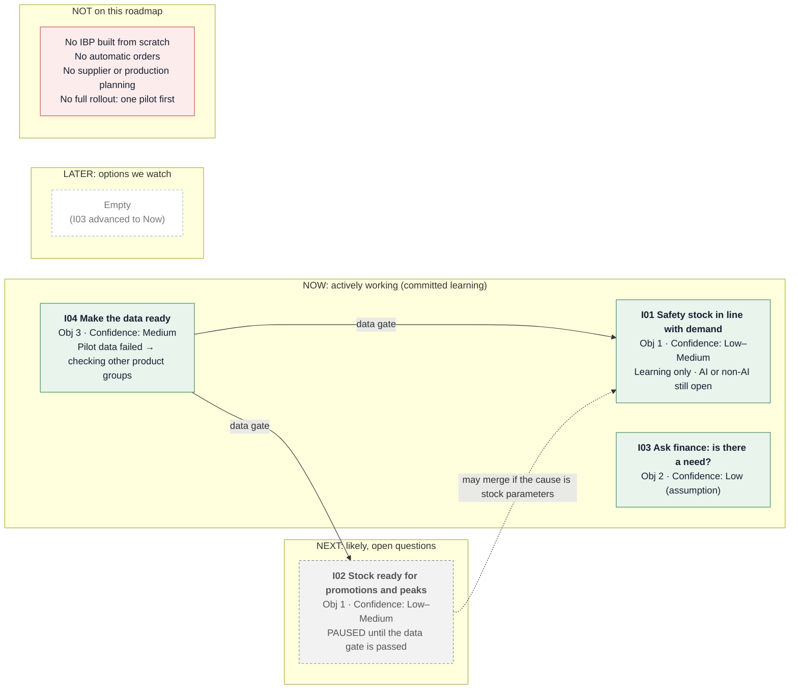

# Product Roadmap: Inventory Prediction

**Status:** v3, updated after the roadmap review (scenario event S04), approved
by the group on 2026-11-06. See the change history at the end.

## Purpose, Audience, and Reference Date

- **Purpose:** Show how better inventory prediction, added to the existing
  ERP/IBP system, could reduce stockouts and excess stock. Show what is known,
  what is uncertain, and what could change the direction. AI is one candidate
  approach; whether it is needed is decided after the learning steps.
- **Audience:** Head of Supply Chain and CFO.
- **Decision owner:** Head of Supply Chain.
- **Reference date:** 2026-11-06.
- **Context:** A European snack food manufacturer (anonymised). See
  `strategy-brief.md`.

## Roadmap at a Glance

**How to read it:** the columns show **confidence, not dates**. Arrows show
dependencies: nothing uses predictions until the I04 data gate is passed. Every
recommendation is approved by a person. Version v3, reference date 2026-11-06.

## Format Choice

| Format | Fit | Reason |
|---|---|---|
| **Now-Next-Later** | **Chosen** | High uncertainty (no baselines, data quality unknown, I03 based only on an assumption). The direction must adapt as evidence comes in. |
| Timeline | Rejected | There are no fixed deadlines. Dates would be invented and read as commitments. |
| Outcome-based | Partly fits | The objectives are clear, but outcomes have no baselines or numbers yet. |

The columns are **confidence horizons, not calendar periods**. "Next" does not
mean "next quarter". Items do not move left automatically: new evidence can
advance, pause, merge, or remove them.

## Horizon Definitions

| Horizon | Entry condition | Expected evidence and detail | Exit or review condition |
|---|---|---|---|
| Now | The problem is understood, evidence is available, and an owner and next step are clear | The strongest available evidence plus an active learning plan | The outcome signal has been reviewed → continue, adapt, or stop |
| Next | Strategic fit and a credible opportunity exist, but the cause, dependencies, or approach are still open | Evidence plus named open questions (cause, feasibility, dependencies) | Ready to move to Now, deferred, or rejected |
| Later | A relevant strategic option or assumption is recorded | An early signal or assumption, with its unknowns named | Review trigger reached → advance, keep, or remove |

## Roadmap

| Horizon | Initiative | Objective and expected outcome | Evidence / confidence | Owner (role) | Dependencies / gates | Next learning or review trigger |
|---|---|---|---|---|---|---|
| **Now** *(adapted)* | **I04: Make the data ready for inventory prediction** | Obj 3: data for the pilot passes an agreed quality gate | F04 (S01), **confirmed by F08 (S04, scenario)** / Medium | ERP/IT Lead | IT / ERP team; **gate: IT security and data access approval**; **gate: data quality before predictions are used** (criteria still unknown) | The first pilot group **failed** the data check (F08). Next step: check whether another product group has better data, and switch the pilot if so |
| **Now** *(adapted)* | **I01: Keep safety stock and reorder points in line with real demand** | Obj 1: stock levels follow real demand, giving fewer stockouts **and** less excess stock in the pilot | F03, F05 (S01, S03) / Low–Medium | Inventory Manager | Depends on I04; **gate: a person approves every change** | **Only learning that needs no data continues:** the current parameter process and why the plan does not turn into inventory actions (O05). **The approach decision (AI or non-AI) is paused** until the I04 gate is passed |
| **Now** *(advanced from Later)* | **I03: Give finance an early view of future inventory value and risk**, limited to confirming the need | Obj 2: finance can act early on inventory value and risk | **Assumption only** / Low | Finance contact (to be named by the CFO) | Input from finance | **Only "ask finance whether the need exists" is in Now.** If there is no need, remove I03. Building anything stays an option |
| **Next** *(paused)* | **I02: Get stock ready in time for promotions and seasonal peaks** | Obj 1: fewer stockouts during peaks and less leftover stock afterwards | F06 (S03) / Low–Medium | Not assigned yet | Depends on I04; promotion data from sales | **Paused** until the I04 gate is passed. Then: find the cause of the peak problems. If the cause is parameters, **may merge with I01**. If the cause is outside inventory, stop |

**Note on capacity:** Now holds three items, but two are reduced to small
learning tasks (I01 learning that needs no data; I03 asking finance). The main
effort is I04.

**Owners** are proposed roles, not confirmed people. The Head of Supply Chain
confirms them.

## Explicit Exclusions

| Not on this roadmap | Reason |
|---|---|
| Developing an IBP system from scratch | The existing planning capability is kept and extended |
| Automatic purchase orders | The AI or tool only suggests, and a person approves every order |
| Supplier and production planning | Out of scope for now, to keep the focus on inventory |
| Full rollout to all plants or product groups | Start with one plant or product group, and learn before scaling |
| Using vendor figures (S02) as targets | They are unverified marketing claims |

## Commitment Language

| Level | Applies to | Meaning |
|---|---|---|
| **Committed** | I04 (checking alternative product groups and data assessment); I01 learning that needs no data; I03 asking finance about the need | The group intends to do this work now, **subject to capacity approval by the Head of Supply Chain** |
| **Exploratory (paused)** | The I01 solution approach (AI or non-AI) | Decided only after the I04 data gate is passed |
| **Exploratory (paused)** | I02 | Paused until the I04 gate is passed |
| **Option** | Building anything for I03 | Only if finance confirms the need |
| **Fixed** | None | There are no fixed dates or external obligations |

No delivery dates are given. No outcome targets are set until baselines exist.

## Open Unknowns (from the audit)

| Unknown | Decision trigger |
|---|---|
| Which plant or product group is the pilot (the first choice failed the data check) | Chosen after checking alternative product groups in I04 |
| Whether any product group has data good enough for prediction | I04 data check results |
| The data quality gate's criteria and who approves them | Agreed with the ERP/IT Lead during I04 |
| Team capacity and budget | Head of Supply Chain approval before work starts |
| Whether AI is needed, or a simpler method is enough | After the I01 learning step |

## Change History

| Version | Date | Change | Reason |
|---|---|---|---|
| v1 | 2026-11-06 | First roadmap: Now = I04, I01; Next = I02; Later = I03 | Initial placement |
| v2 | 2026-11-06 | Renamed the roadmap; confidence lowered to Low–Medium; owners and IT security gate added; the AI approach left open; unknowns recorded | Roadmap audit (see `roadmap-decision-log.md`) |
| v3 | 2026-11-06 | I04 adapted (check alternative product groups); I01 adapted (only learning that needs no data, approach decision paused); I02 paused; I03 "ask finance" advanced from Later to Now | **Scenario event S04 (fictional):** the pilot data failed the quality check. See `roadmap-review.md` |
